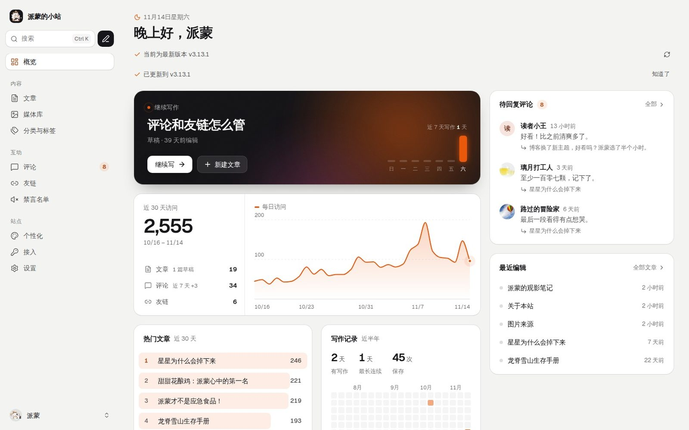
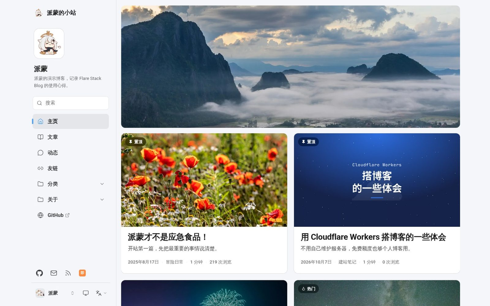
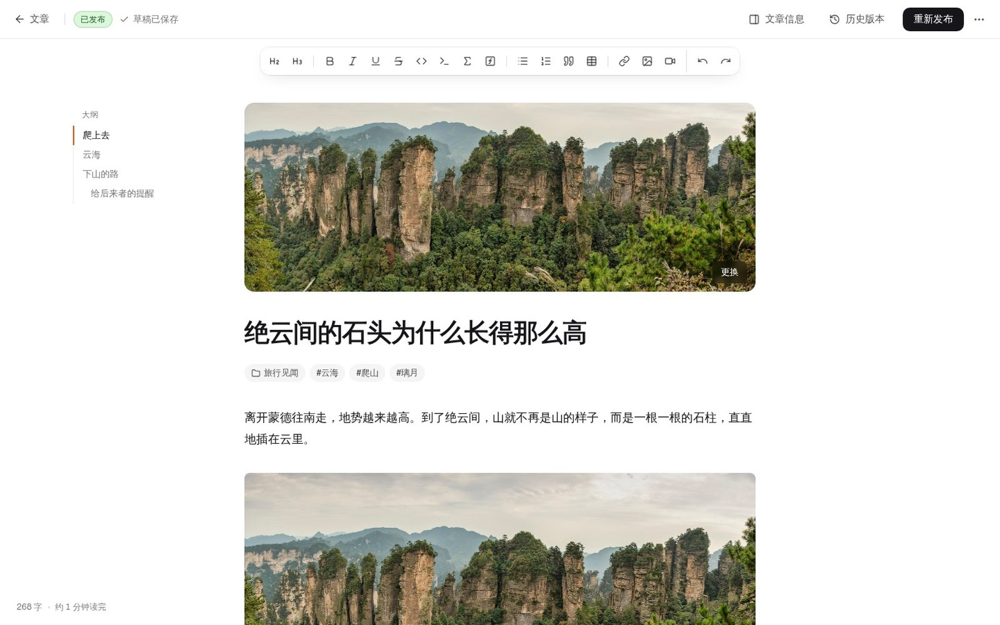
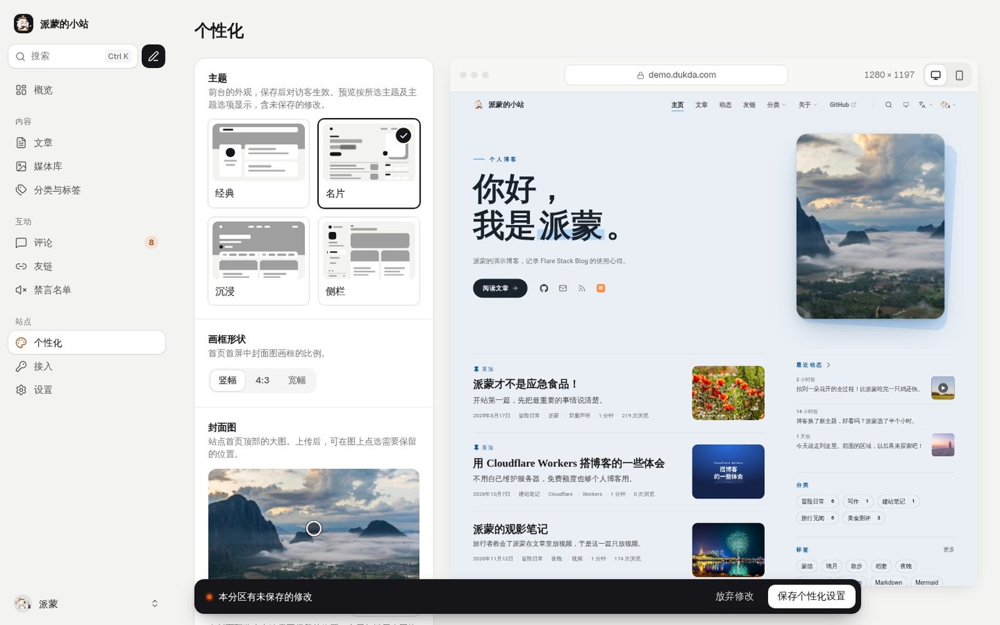

<div align="center">


# Flare Stack Blog

基于 **Cloudflare 边缘生态**打造的高性能全栈博客与 CMS 系统<br>
利用 Workers、D1、R2、KV 与 Queues 实现真正的全 Serverless 架构

[](https://github.com/du2333/flare-stack-blog/blob/main/LICENSE)
[](https://github.com/du2333/flare-stack-blog/stargazers)
[](https://github.com/du2333/flare-stack-blog/network/members)
[](https://react.dev)
[](https://tanstack.com/start)
[](https://tailwindcss.com)

[在线演示](https://demo.dukda.com) · [部署指南](./docs/deployment.md) · [视频教程](https://www.bilibili.com/video/BV1iQHr6NEcC/) · [本地开发](#本地开发) · [贡献指南](./CONTRIBUTING.md) · [交流群组](https://t.me/+vWuQYybv1kgxMDkx)

</div>

---

Flare Stack Blog 是一个深度拥抱 Cloudflare 生态的开源独立博客系统。前端基于 React 19 和 TanStack 现代全栈框架构建，内置经典、名片、沉浸、侧栏四套主题，其中经典主题承袭清新简约的 [Fuwari](https://github.com/saicaca/fuwari) 视觉风格；后端完全运行于 Cloudflare Workers 边缘网络，搭配 D1、R2、KV 与异步队列，无需传统服务器即可享受极速的全球访问体验与近乎零成本的运维。

> [!NOTE]
> 本项目专为 Cloudflare Workers 边缘运行时设计。

## 界面预览

<div align="center">
  
  
</div>

<div align="center">
  
  
  
</div>

<div align="center">
  
  
  
</div>

<div align="center">
  <sub>第一行：首页（沉浸主题）、后台概览；第二行：经典、名片、侧栏主题；第三行：动态、文章编辑器、个性化设置。<br>
  截图取自<a href="https://demo.dukda.com">在线演示</a>，其中的照片来自维基共享资源，作者与许可见演示站的<a href="https://demo.dukda.com/post/image-credits">图片来源</a>。</sub>
</div>

## 功能特性

- 🎨 **主题与个性化**
  - **四套内置主题**：经典、名片、沉浸、侧栏，各有自己的页面骨架、导航与卡片样式；在后台切换后，所有公开页面立即换用，内容不受影响。
  - **个性化设置与实时预览**：主题、主色、封面图及其焦点位置、头像、品牌标识与标语集中在一页设置，保存前即可在预览中查看效果。
  - **导航分组**：一个导航链接下可挂一组子链接，各主题以菜单形式展开。

- 📝 **创作与内容管理**
  - **现代化富文本编辑器**：基于 TipTap 与 Shiki，原生支持代码语法高亮、数学公式、Mermaid 图表、多尺寸媒体插入与文章封面，并可嵌入 Bilibili、YouTube 与直链视频。
  - **动态**：无标题的短内容，可带最多 50 张图片或一段视频，发布后立即公开，支持评论与分享。
  - **版本快照与历史回滚**：发布文章时自动归档快照，可随时查看任意历史版本并一键恢复。
  - **分类与标签体系**：支持文章单分类与多标签灵活组合筛选。
  - **媒体库**：以照片墙浏览，支持按文件名搜索、按上传时间或文件大小排序，并可查看图片被哪些文章与动态引用。
  - **站内实时全文检索**：用 Cloudflare D1 FTS 索引已发布文章的标题、摘要、分类、标签与正文。

- 💬 **互动与读者体验**
  - **评论与社区互动**：文章与动态均可评论，支持嵌套层级回复、访客防刷保护、评论软删除与违规用户禁言管理；后台以收件箱形式集中处理待回复的评论。
  - **阅读体验**：文章图片可放大浏览，标题带锚点链接，目录显示阅读进度，长期未更新的文章会提示读者，文章与动态可调用系统分享面板分享。
  - **友情链接流转**：前台提供规范的申请表单，后台支持一键审核通过、驳回反馈与邮件即时联动。
  - **国际化多语言**：公开阅读界面与管理后台均完整支持中英文无缝切换。

- ⚡ **边缘基础设施**
  - **全 Serverless 存储栈**：以 Cloudflare D1 作为主关系型数据库，KV 承担高频缓存，Durable Objects 负责精准访问限流。
  - **全球静态资产加速**：媒体文件直存 R2 存储桶，配合 Cloudflare Images 绑定在 Worker 内实现实时图片缩放与格式优化。
  - **异步队列事件解耦**：通知邮件发送与 Webhook 派发经由 Cloudflare Queues 异步队列处理，接口响应零阻塞。

- 🛠️ **系统与扩展能力**
  - **安全身份认证**：集成 Better Auth，支持 GitHub OAuth 快捷登录，以及发送到邮箱的 6 位登录码（无密码；需在后台配置邮件发送后启用）。
  - **通知推送**：新评论、回复和友链申请可推送到 Telegram、Discord、飞书、钉钉、企业微信、Bark、ntfy，或带签名的通用 JSON 与自定义模板，详见 [Webhook 推送](docs/webhook.md)。
  - **开放 API 接口与 Agent Skill**：支持在后台签发 API Key，通过规范化 OpenAPI / oRPC 接口对接第三方自动化工具或发布脚本；博客自带 Agent Skill，AI agent 凭配对码接入后可撰写、上传图片并发布文章。
  - **版本更新提示**：后台概览按补丁、小版本、大版本提示可用更新，并附各版本的一句话摘要；跨大版本升级时，部署会在迁移数据库之前停下，列出需要先完成的事项。
  - **访问分析与 SEO**：内建 Umami 统计与文章热度自动同步，开箱支持 Canonical、Schema.org、RSS / Atom / JSON Feed、Sitemap 与 Robots 标准。

## 技术栈

| 模块 | 选型 | 说明 |
| :--- | :--- | :--- |
| **边缘运行时** | Cloudflare Workers | 全球边缘免运维托管与服务端流式渲染（SSR） |
| **数据与存储** | Cloudflare D1 + R2 + KV | 关系型数据库（含全文检索）、对象存储与边缘键值缓存 |
| **异步与限流** | Cloudflare Queues + DO | 异步任务解耦队列与 Durable Objects 请求限流 |
| **全栈框架** | TanStack Start + Router + Query | 现代全栈路由系统、服务端数据预取与水合 |
| **前端技术** | React 19 + Tailwind CSS 4 | 现代化组件开发与主题样式系统 |
| **API 与 ORM** | oRPC + Drizzle ORM | 端到端类型安全的 OpenAPI 接口与 SQL ORM |
| **身份认证** | Better Auth | 边缘兼容的现代化身份验证服务 |
| **富文本** | TipTap + Shiki | 可扩展的所见即所得编辑器与代码高亮引擎 |

## 部署指南

使用 GitHub 与 Cloudflare Workers Builds 部署，请阅读独立的 [图文部署指南](./docs/deployment.md)，包含首次部署、可选配置和后续更新。

## 本地开发

开发环境要求：[Bun](https://bun.sh) >= 1.3。

### 1. 安装依赖与初始化配置

```bash
# 克隆仓库并安装依赖
git clone https://github.com/du2333/flare-stack-blog.git
cd flare-stack-blog
bun install

# 复制本地配置文件模板
cp .env.example .env
cp .dev.vars.example .dev.vars
```

参考 `.env` 与 `.dev.vars` 中的注释完成基础项配置。本地开发通过 Miniflare 本地模拟 D1、KV 和 R2 存储服务，Worker 配置位于 `cloudflare.config.ts`，未设置部署变量时会使用占位符直接启动。该配置需要 Node ≥ 24（见 `.node-version`）。

### 2. 启动本地开发服务

```bash
bun dev
```

在浏览器中打开 `http://localhost:3000` 即可开始预览。

> [!TIP]
> - 本地开发模式下不会真实投递邮件，登录码会连同邮件内容直接打印在终端控制台中。登录页只有在后台配置了邮件发送服务后才会显示邮箱登录。
> - 本地数据库中第一个创建的用户同样会自动成为管理员。

### 常用开发脚本

| 命令 | 说明 |
| :--- | :--- |
| `bun dev` | 启动本地开发服务（默认监听端口 3000） |
| `bun check` | 提交前综合检查（包含 OpenAPI 合约生成、代码格式校验、Lint 与 TypeScript 类型检查） |
| `bun test` | 执行全量集成与单元测试套件 |
| `bun db:migrate:local` | 对本地模拟数据库应用 D1 数据库迁移 |
| `bun db:studio` | 启动本地 Drizzle Studio 可视化数据库管理界面 |
| `bun i18n:verify` | 检查并校验多语言词条键值完整性（zh / en 一致性） |
| `bun i18n:compile` | 重新编译并生成 Paraglide 多语言运行时产物 |

## 参与贡献

非常欢迎任何形式的贡献！无论是新功能提议、代码重构还是文档润色，都可以先阅读 [CONTRIBUTING.md](./CONTRIBUTING.md) 了解我们的协作流程。

欢迎加入我们的 [Telegram 交流群](https://t.me/+vWuQYybv1kgxMDkx) 与其他开发者一起交流探讨。

## 致谢

- **[Fuwari](https://github.com/saicaca/fuwari)**：经典主题优雅清新的界面与动效设计灵感源自 [@saicaca](https://github.com/saicaca) 优秀的开源博客主题。

## 开源协议

本项目采用 [GPL-3.0](https://github.com/du2333/flare-stack-blog/blob/main/LICENSE) 协议开源。
